# 电控第一次作业说明文档

STM32F103 GPIO 定时器与独立看门狗


## 一 实验内容与工程结构

本实验在同一个 STM32CubeMX 工程中完成 GPIO 输出、定时器计数与独立看门狗复位。第二题使用定时器中断累计 `tick` 并定时喂狗，第三题停止喂狗以观察复位。Ozone 连续监视结果显示，第二题 `tick` 约每秒增加 1000，第三题出现增长后回落的循环现象。

| 项目 | 配置 |
| --- | --- |
| 工程与芯片 | RM_EC_HW1；STM32F103C8T6 |
| 时钟与调试 | HSI 8 MHz；AHB、APB1、APB2 分频均为 1；SWD |
| LED 与定时器 | PC13 推挽输出；TIM2 更新中断 |
| IWDG | LSI 时钟；Prescaler 64；Reload 1249 |
| 构建与观察 | CMake Debug；Ozone V3.50 的 Watched Data |

业务代码位于 `Tasks/src/tasks.c`，接口位于 `Tasks/inc/tasks.h`。`main.c` 仅在 `USER CODE` 区包含 `tasks.h`，并在外设初始化后调用 `Tasks_Init()`；`while (1)` 保持为空。定时器回调只在 Tasks 中实现一份。当前工程保存的是第三题版本，同时保留了第二题版本的注释。

## 二 第一题 GPIO 输出

PC13 配置为推挽输出、无上下拉、低速。`Tasks_Init()` 将 PC13 写为低电平，按 F103 最小系统板的低电平有效接法点亮板载 LED；主循环不翻转该引脚。

```c
HAL_GPIO_WritePin(GPIOC, GPIO_PIN_13, GPIO_PIN_RESET);
```

IWDG 从第一题开始保持启用。单独验证第一题时若不喂狗，芯片会在超时后复位；第二、三题继续保留 PC13 的初始化输出。LED 实物照片置于附录 A。

## 三 第二题 定时器更新中断

### 时钟来源与周期计算

SYSCLK 选择内部 HSI，频率为 8 MHz。AHB 分频为 1，因此 HCLK 为 8 MHz；APB1 分频也为 1，因此 PCLK1 和 TIM2 输入时钟均为 8 MHz。此配置下不发生定时器时钟倍频；只有 APB1 分频不为 1 时，才需按该芯片时钟树考虑定时器时钟为 PCLK1 的 2 倍。

TIM2 采用向上计数，预分频寄存器 PSC = 7，自动重装载寄存器 ARR = 999。预分频后计数频率为 1 MHz，计满 1000 个计数后产生更新中断。

$$
T = \frac{(\mathrm{PSC}+1)\times(\mathrm{ARR}+1)}{f_{\mathrm{TIM2}}}=0.001\,\mathrm{s}
$$

$$
T = \frac{(7+1)\times(999+1)}{8\,000\,000}\,\mathrm{s}=1\,\mathrm{ms}
$$

### 初始化与回调实现

`tick` 定义为全局 `volatile uint32_t`，保证调试器可以按变量名观察它。初始化时清除配置定时器产生的更新标志，再通过 `HAL_TIM_Base_Start_IT(&htim2)` 启动中断。`TIM2_IRQHandler` 调用 `HAL_TIM_IRQHandler`，最终进入以下回调。

```c
volatile uint32_t tick = 0U;

/* 第二题版本 */
void HAL_TIM_PeriodElapsedCallback(TIM_HandleTypeDef *htim)
{
    if (htim->Instance != TIM2)
    {
        return;
    }
    tick++;
    if (HAL_IWDG_Refresh(&hiwdg) != HAL_OK)
    {
        Error_Handler();
    }
}
```

第二题每次中断喂狗，避免 IWDG 超时打断 `tick` 的持续增长。计数不依赖 `HAL_Delay` 或主循环。该版本包含 `iwdg.h`；第三题在同一工程中移除喂狗调用。

### 监视结果

保持 CPU running，Watched Data 中 `tick` 每秒增加约1000，与每 1 ms 增加 1 的设计一致。对应截图见附录 B。

## 四 第三题 独立看门狗复位

### 超时计算与代码修改

IWDG 继续启用，保持 Prescaler = 64、Reload = 1249。按作业给出的 F103 LSI 约 40 kHz 计算，名义超时时间如下；实际周期受 LSI 振荡频率偏差影响。

$$
T = \frac{(\mathrm{Reload}+1)\times\mathrm{Prescaler}}{f_{\mathrm{LSI}}}
$$

$$
T = \frac{(1249+1)\times64}{40\,000}\,\mathrm{s}=2\,\mathrm{s}
$$

第三题删除 `Tasks_Init()` 和更新回调中的 `HAL_IWDG_Refresh` 调用，定时器周期保持 1 ms，`tick` 仍在中断中自增。当前 Tasks 中的回调为：

```c
volatile uint32_t tick = 0U;

/* 第三题版本 */
void HAL_TIM_PeriodElapsedCallback(TIM_HandleTypeDef *htim)
{
    if (htim->Instance != TIM2)
    {
        return;
    }
    tick++;
}
```

没有在回调中按阈值手动清零 `tick`。看门狗超时后硬件复位，启动代码重新初始化全局变量，`Tasks_Init()` 也在启动时将 `tick` 置零，因此程序重新开始计数。名义上应在约 2000 附近发生复位。

截图期间 Ozone 显示 CPU running。反复震荡的现象与 IWDG 超时复位一致。连续截图见附录 C。

### 构建与实验结论

第二题、第三题均通过 CMake Debug 编译。第三题固件位于 `build/project.elf`，构建命令为 `cmake --build --preset Debug`。观察时让程序持续运行，避免停在断点上使看门狗继续计时而干扰调试。

## 附录 A GPIO 实物照片

图 A1 板载 LED 点亮照片：
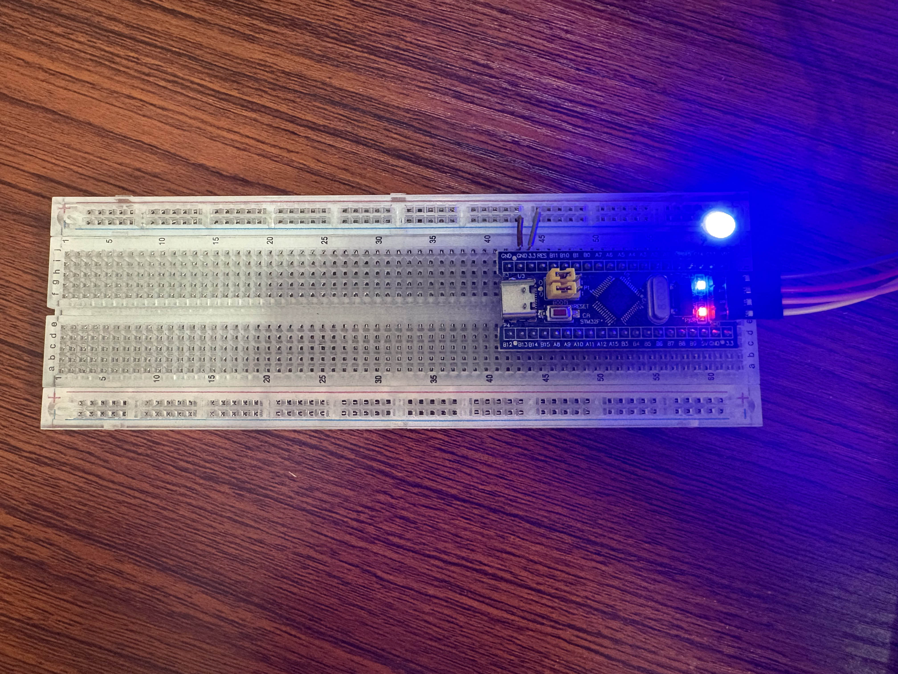

## 附录 B 第二题连续监视截图

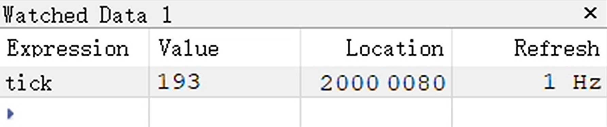

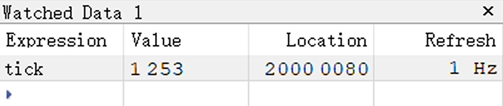

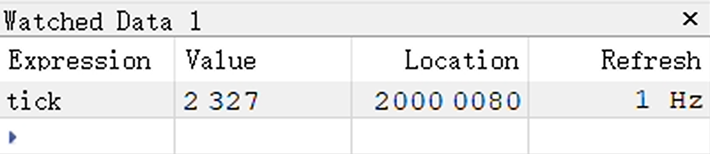

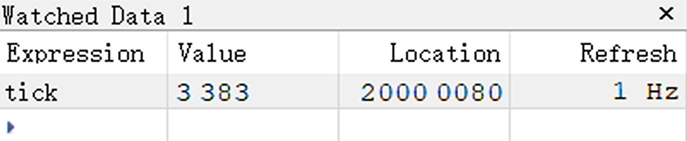

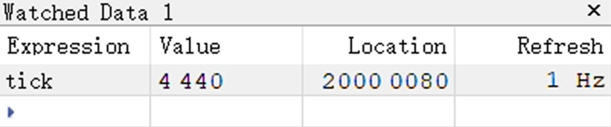

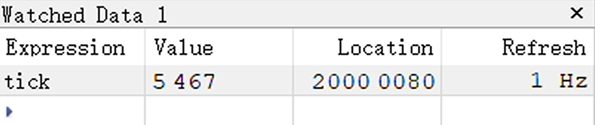


## 附录 C 第三题连续监视截图

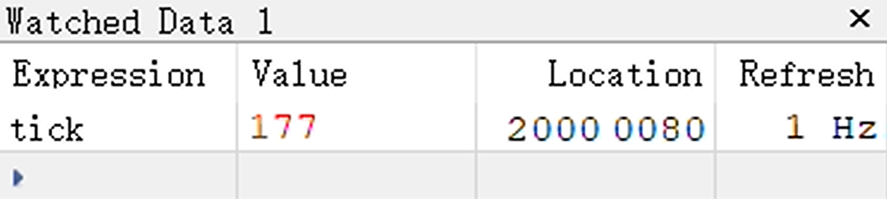

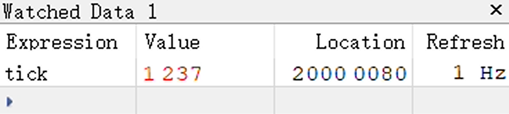

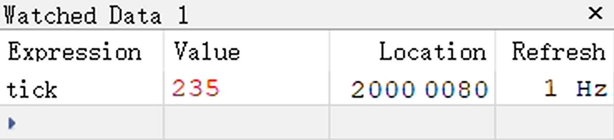

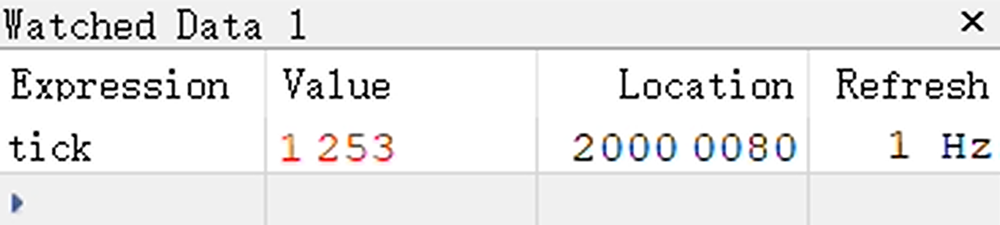

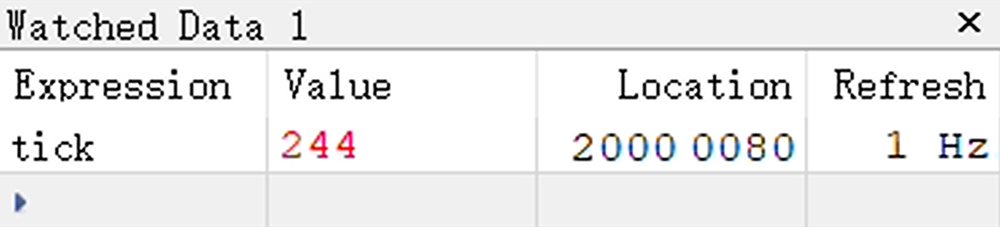

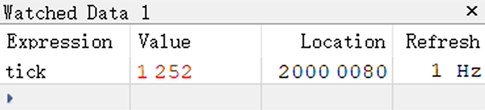